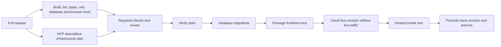

# Matjakt

React/TypeScript grocery price comparison application with Supabase Auth and PostgreSQL. The isolated project frontend runs on Cloud Run; the original Matjakt environment is managed separately. This README contains the setup and operating instructions needed for submission. The final report is submitted separately.

- [Live application](https://matjakt-course-s6jsqt6gca-lz.a.run.app)
- [Tagged preview](https://course-preview---matjakt-course-s6jsqt6gca-lz.a.run.app)
- Google Cloud project: `project-d3caac43-e28e-41c8-940`, region `europe-north1`.
- Supabase project: `ixrkepmiwiyqdvckqflt`, Adams Org, Stockholm region.

The original Supabase project `qzpyabesygoljpohguxw` and Firebase project `matjakt-27b7f` are not deployment targets. Deployment guards reject these original identifiers.

## Run from a clean clone

Requirements: Node **24.15.0**, pnpm **10.34.6** and a running Docker engine. The package manager is pinned in `package.json`; install it with `npm install --global pnpm@10.34.6` if needed.

```sh
pnpm install --frozen-lockfile
pnpm run db:start
pnpm run dev
```

`db:start` starts the local Supabase stack `matjakt`, applies migrations and seeds synthetic products. It writes browser-safe local credentials to ignored `.env.local`; `pnpm run env:local` regenerates that file. No cloud credentials are required. The local API uses `http://127.0.0.1:55321` and PostgreSQL port 55322.

```sh
pnpm run verify
pnpm audit --audit-level=high
pnpm run test:db
pnpm exec playwright install chromium
pnpm run test:e2e
pnpm run db:stop
```

`verify` runs lint, TypeScript, unit tests and a production build. Browser tests run the built app on port 4173 against real local Supabase. Routing and map tiles are mocked; a deliberately failed backend response tests error handling. `pnpm run db:reset` deliberately clears the local database and reapplies migrations/fixtures. Never reset the hosted database.

## Architecture and CI/CD

- `src/`: React application and browser Supabase client.
- `supabase/`: local configuration, ordered migrations, synthetic seed and pgTAP tests.
- `tests/`: unit tests and Playwright journeys/smoke tests.
- `infra/`: Terraform for Cloud Run, registry, IAM/OIDC, retained state backup and budget notifications.
- `scripts/`: database setup/migration, guarded release, rollback and optional catalog import.
- `Dockerfile` and `deploy/nginx.conf`: serve a prebuilt frontend using unprivileged nginx and SPA fallback.
- `.github/workflows/ci.yml`: verification and main release; `.github/dependabot.yml`: dependency updates.



The browser accesses Supabase Auth and the Data API directly. SQL grants and row-level security restrict catalog reads and isolate authenticated profiles. Pull-request jobs receive no deployment credentials. The aggregate `CI gate` requires application/database verification and Terraform formatting to succeed. HCP planning is enforced independently through the required GitHub status `Terraform Cloud/einar-org/repo-id-xYJjys86WtdnrsLN`.

A successful main workflow rebuilds the frontend with hosted settings, applies migrations, packages the resulting build without rebuilding inside Docker, deploys a tagged zero-traffic revision and promotes it only after smoke tests pass. Releases are serialized and reject obsolete main commits. `/version.json` records the source commit and whether a manual build contained uncommitted changes. `output/deployment/release.json` records image/revision, URLs, previous traffic and promotion/test status; Actions retains it with browser artifacts.

## GitHub deployment settings

Configure the protected GitHub environment **`course`** for main releases. Main protection requires an up-to-date CI gate, the HCP status, configured security checks, review and resolved discussions. If the HCP repository connection changes, check the actual posted status before updating protection.

GitHub variables and secrets use the following names. The workflow maps the public Supabase settings to the frontend variables:

| GitHub setting | Kind | Script variable or action input |
| --- | --- | --- |
| `GCP_PROJECT_ID` | Variable | `GCP_PROJECT_ID` |
| `GCP_REGION` | Variable | `GCP_REGION` |
| `RUN_SERVICE` | Variable | `RUN_SERVICE` |
| `IMAGE_REPOSITORY` | Variable | `IMAGE_REPOSITORY` |
| `WORKLOAD_IDENTITY_PROVIDER` | Variable | Google auth `workload_identity_provider` |
| `DEPLOY_SERVICE_ACCOUNT` | Variable | Google auth `service_account` |
| `SUPABASE_PROJECT_REF` | Variable | `SUPABASE_PROJECT_REF` |
| `SUPABASE_URL` | Variable | `VITE_SUPABASE_URL` |
| `SUPABASE_PUBLISHABLE_KEY` | Variable | `VITE_SUPABASE_PUBLISHABLE_DEFAULT_KEY` |
| `SUPABASE_DB_URL` | Secret | `SUPABASE_DB_URL`, migration step only |

Google settings come from `terraform -chdir=infra output -json github_variables`. Its output keys match the Google GitHub variable names above. Supabase supplies the project ref, HTTPS API URL and publishable key.

`SUPABASE_URL` is the public HTTPS API address, `https://ixrkepmiwiyqdvckqflt.supabase.co`, included in the frontend alongside the publishable key. Access is enforced by Auth, grants and RLS. `SUPABASE_DB_URL` is a password-bearing PostgreSQL connection used to apply migrations. Obtain the session-pooler connection from Supabase: user `postgres.<project-ref>`, port 5432 and `sslmode=require`. The guard checks the project ref, host, TLS, port and password. Never put this connection in a `VITE_` variable or commit its value. No personal Supabase API token or Google service-account key is needed for the release workflow.

## Infrastructure and hosted database setup

[HCP Terraform](https://app.terraform.io/app/einar-org/workspaces/matjakt-course) owns active state and execution: organization `einar-org`, workspace `matjakt-course`, repository `einhar1/matjakt`, branch `main`, working directory `infra`. Pull requests receive speculative plans; infrastructure changes merged to main trigger automatic plan/apply. Application-only changes do not trigger infrastructure runs. A passing PR plan does not prove a later apply succeeded.

HCP Terraform variables are `project_id`, `billing_account_id`, `github_repository_id`, `github_repository` and `region`; `infra/terraform.tfvars.example` describes the inputs. Configure the four environment variables returned by `terraform -chdir=infra output -json hcp_authentication`, plus `GOOGLE_CLOUD_QUOTA_PROJECT` set to the deployment project. HCP uses separate plan/apply identities and workspace-restricted Google OIDC. GitHub uses repository/main/workflow-restricted OIDC. Do not configure downloaded service-account keys.

For authenticated read-only inspection:

```sh
terraform login
terraform -chdir=infra init
terraform -chdir=infra output -json github_variables
terraform -chdir=infra output -json hcp_authentication
```

The existing workspace must remain the sole active state owner. Do not apply locally or create a second state against the same resources. Fresh infrastructure establishment requires an existing billed Google Cloud project, Google ADC with provisioning permissions and initial creation of HCP OIDC trust. Migrate bootstrap state into the intended workspace with interactive `terraform init`, then configure remote execution, VCS, variables, auto-apply and queue-all-runs before normal releases. The retained private GCS bucket is historical backup, not the active backend.

Terraform owns service configuration; release scripts own the image, revisions and traffic. Terraform ignores those release fields. Internal resource renames are recorded in `infra/moved.tf`. Cloud Run scales to zero with at most two instances; its runtime identity has no project roles. Budget notifications warn at 50/100 SEK without limiting spending. Supabase compute and retained images add separate costs. Service, registry and state backup have destruction protection.

Hosted Supabase creation is a manual bootstrap step. The schema preserves app-facing contracts compared with a read-only original-schema export, adds restricted grants/profile policies and PostGIS distance selection, and excludes crawler/history tables. On a fresh isolated backend, export the neutral deployment variables and `SUPABASE_DB_URL`, run `pnpm run db:migrate` to validate the target and apply migrations, then seed once with `pnpm exec supabase db push --db-url "$SUPABASE_DB_URL" --include-seed --yes` (shell syntax). Releases use `pnpm run db:migrate` without reseeding. Do not seed an existing hosted catalog or edit already applied migrations.

For hosted API/Auth settings, copy `supabase/hosted.config.toml.example` to an ignored workdir at `supabase/config.toml`. Substitute live and preview URLs, then inspect differences before applying:

```sh
pnpm exec supabase config diff --project-ref <project-ref> --workdir <private-workdir>
pnpm exec supabase config push --project-ref <project-ref> --workdir <private-workdir> --yes
```

The hosted API exposes `public` and `coop`, with search path `public, extensions`. Auth uses the live site and tagged-preview redirect URL, with email confirmation enabled. Local disposable accounts bypass confirmation only in development. `public.mv_active_deals` contains public catalog data, requires refresh after catalog changes and has a documented advisor warning because materialized views do not enforce RLS.

## Release and recovery

Normal release runs automatically after verified main pushes. A failed preview leaves live traffic unchanged. A failed live check requires inspecting the recorded release metadata and selecting a previous revision.

Manual bootstrap uses local gcloud/Docker credentials. Store the neutral script variables from the table in ignored `.env.deployment.local`; then run:

```sh
gcloud auth configure-docker europe-north1-docker.pkg.dev --quiet
pnpm run build:production
pnpm run bootstrap
```

`bootstrap` explicitly selects manual mode; `deploy` never silently falls back to it. Normal local builds continue to use `.env.local`. A manual bootstrap is separate from evidence of an Actions release.

For rollback, choose an existing revision from release metadata or `gcloud run revisions list`. Set `GCP_PROJECT_ID`, `GCP_REGION`, `RUN_SERVICE` and `ROLLBACK_REVISION`, then run `pnpm run rollback`. Set `PLAYWRIGHT_BASE_URL` to live and `GITHUB_SHA` to the restored revision's source commit, then run `pnpm exec playwright test smoke.spec.ts`. Keep previous images/revisions available and avoid overlapping manual operations with releases.

Preview and live share the database, so migrations must remain backward compatible. Rollback changes frontend traffic only; database defects require forward corrective migrations.

## Catalog and verification evidence

Local/CI fixtures are synthetic. The hosted catalog is a one-time approved snapshot with 89,618 products, 538 stores and 5,940,377 prices, plus three fuel prices. No accounts/profiles were copied and no ongoing price synchronization is configured. Imported counts matched, price references were valid and profile data remained unchanged. Hosted search/details/cart checks confirmed price calculations; this was not a performance benchmark.

The optional importer does not run in CI and is unnecessary for local reproduction. It needs PostgreSQL 17 dump/restore tools and read-only exports of only `products`, `stores` and `current_prices` in `public`/`coop`, plus `public.fuel_prices`. Keep `production-catalog.sql` and the destination backup `target-before.sql` in ignored `output/catalog-copy/`. After destination migrations and disk-capacity checks, run `node scripts/import-catalog.mjs prepare`, then `node scripts/import-catalog.mjs apply` with `SUPABASE_DB_URL` or ignored `output/db-url.local`. Preparation creates checksums and a staged import; apply validates them and replaces only catalog data in one transaction, retaining RLS and checking profile invariance. Keep the backup for a guarded catalog-only restore and refresh the deals view afterwards. Never restore an entire production database or reset the hosted project.

Recorded workflow evidence:

- [Intentional failed CI gate](https://github.com/einhar1/matjakt/actions/runs/37128787926): incorrect fuel-cost assertion blocked release; subsequently corrected.
- [Successful main release](https://github.com/einhar1/matjakt/actions/runs/37131650365): migration, OIDC, preview and live checks passed with matching clean source metadata.
- [HCP automatic apply](https://app.terraform.io/app/einar-org/workspaces/matjakt-course/runs/run-XNzxH5XxuZUUybFU) and [subsequent no-change plan](https://app.terraform.io/app/einar-org/workspaces/matjakt-course/runs/run-f6DcdhoHRbTzhJTp).

These are historical observations, not a claim about every later revision. Traffic recovery was exercised between revisions with identical artifacts, demonstrating traffic restoration rather than correction of defective code. The project members have manually reviewed the code and configuration. Price collection, production-scale performance and a separate observability system are outside scope. Retain the environment through grading; review costs, backups and destruction protection before cleanup.

## AI assistance and naming

OpenAI Codex assisted with architecture analysis, implementation, configuration, migrations, tests, verification, catalog import and documentation. The project members made architectural decisions and manually reviewed generated code and configuration. Automated checks supplemented that review; responsibility remains with the authors.

Source commands, scripts, Terraform addresses and GitHub variable/secret names use neutral names. The workflow reads these GitHub names directly and maps public Supabase settings to frontend variables. The `course` environment, deployed resource IDs, HCP workspace and `course-preview` tag remain compatibility bindings. Historical migration identifiers remain unchanged; Terraform `moved` blocks preserve state continuity for renamed internal addresses.
